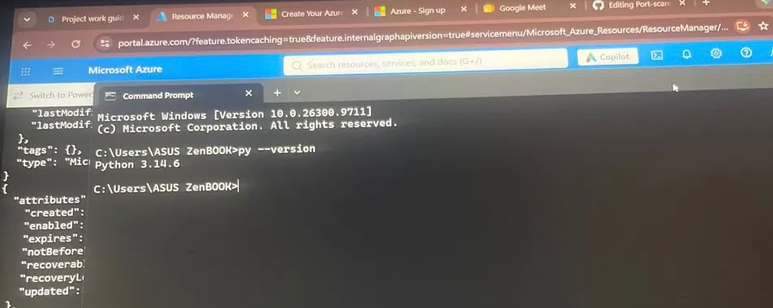
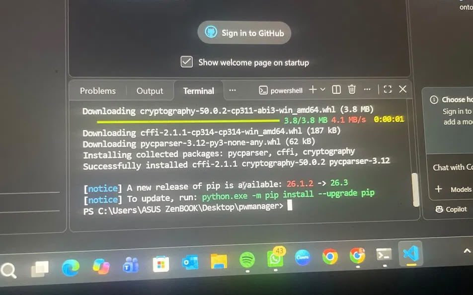
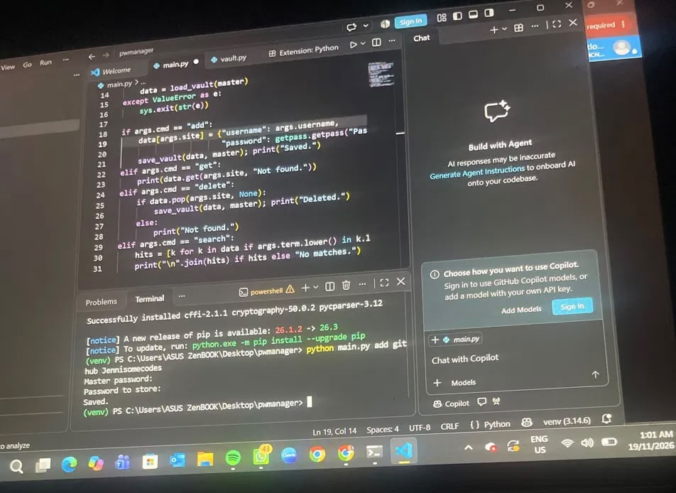
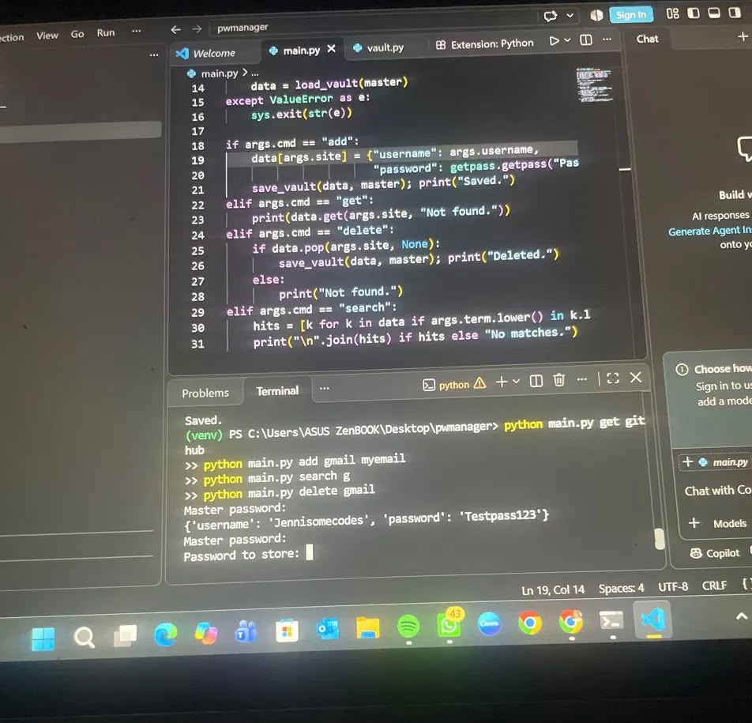
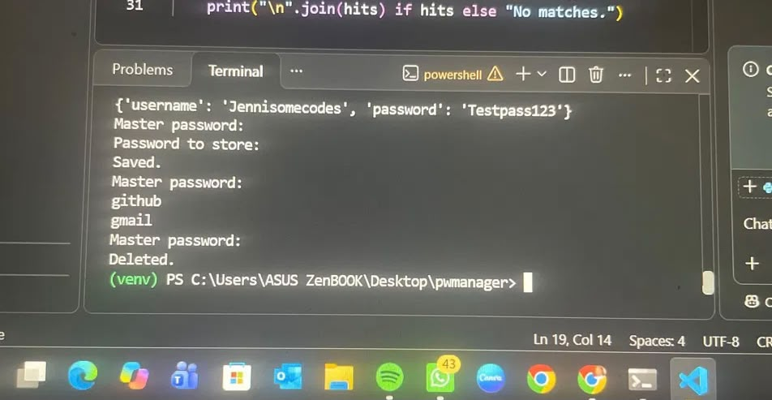
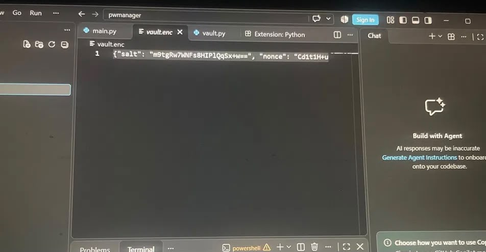
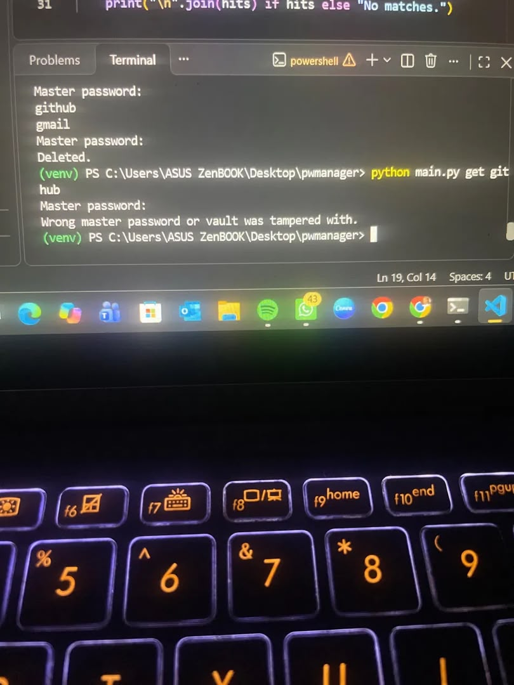
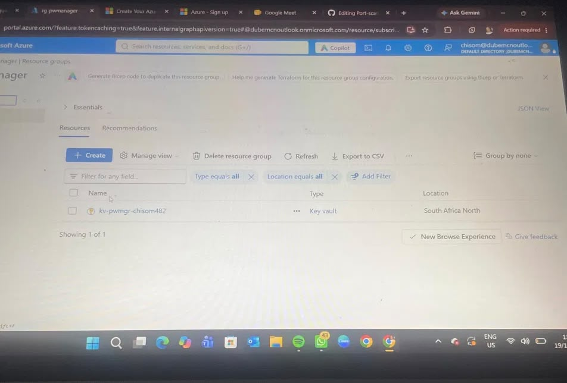

# Password Manager

A local command-line password manager written in Python. Credentials are stored
encrypted on disk using **AES-256-GCM** and protected by a master password.
Built as Project 2 (Password Manager) with an Azure Key Vault provisioned as the
cloud security layer.

## Features
- Add, retrieve, delete and search password entries
- AES-256-GCM authenticated encryption (detects tampering)
- Master password is never stored; the key is derived with scrypt and a random salt
- Encrypted JSON storage format (`vault.enc`)
- Azure resource group and Key Vault provisioned for the planned cloud extension

## How it works
1. You enter a master password.
2. scrypt turns it into a 256-bit key using a random 16-byte salt.
3. The vault (a JSON object of entries) is encrypted with AES-256-GCM using a
   fresh random 12-byte nonce on every save.
4. `vault.enc` stores only `salt`, `nonce` and `ct` (ciphertext), all base64-encoded.
5. A wrong master password or a modified file fails authentication and is rejected.

## Project structure
```
pwmanager/
├── main.py            # command-line interface
├── vault.py           # encryption, key derivation, storage
├── requirements.txt
├── .gitignore
└── images/            # screenshots
```

## Setup
Requires Python 3.10 or newer.

```
py -m venv venv
venv\Scripts\activate
pip install -r requirements.txt
```

### Step 1: Python installed


### Step 2: Dependencies installed


## Usage
Every command asks for the master password. Use the same one each time.

```
python main.py add github myusername     # asks for the password to store
python main.py get github
python main.py search git
python main.py delete github
```

### Add an entry


### Retrieve an entry


### Search and delete


## Security design

| Requirement | Implementation |
|---|---|
| Strong symmetric encryption | AES-256-GCM |
| Master password | Never stored; derived with scrypt (n=2^15, r=8, p=1) |
| Secure key handling | Key exists only in memory while a command runs |
| Secure local storage | Encrypted JSON (`salt`, `nonce`, `ct`) |
| Tamper detection | GCM authentication tag |

### Encrypted vault file
The saved file contains no readable usernames or passwords.



### Wrong master password is rejected


## Azure
An Azure resource group (`rg-pwmanager`) and Key Vault (`kv-pwmgr-chisom482`) were
provisioned with a secret.



**Planned extension:** mix the Key Vault secret into the key derivation and back up
the encrypted vault to Azure Blob Storage. The current application runs fully
locally and does not yet connect to Azure.

## Notes
- Never commit `vault.enc`; it is listed in `.gitignore`.
- Use test passwords only.
